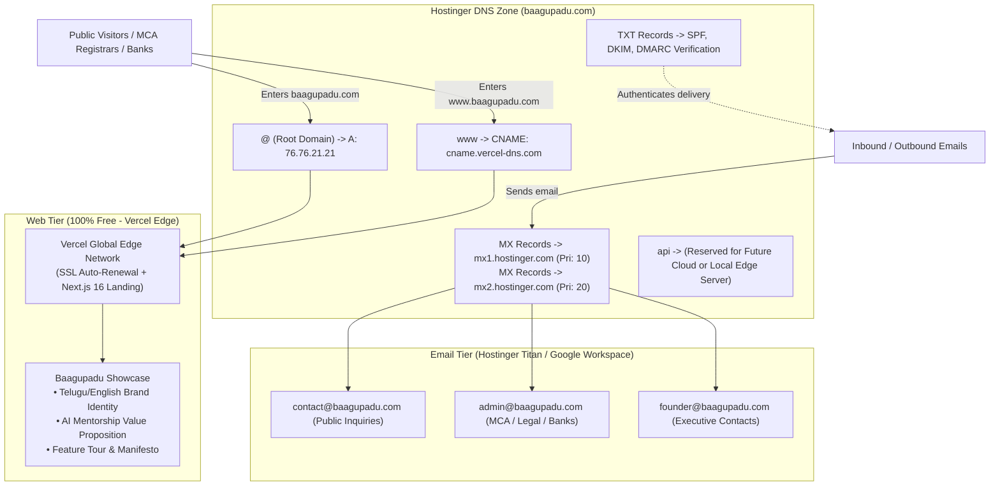
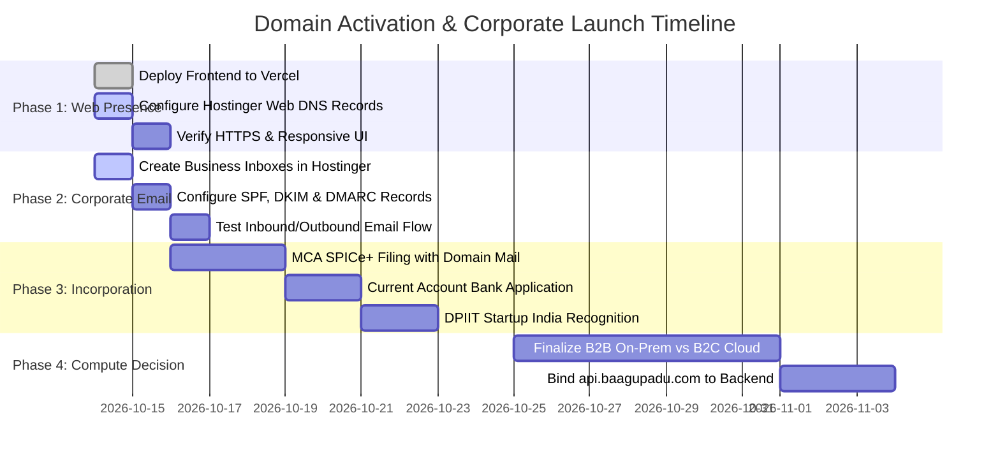
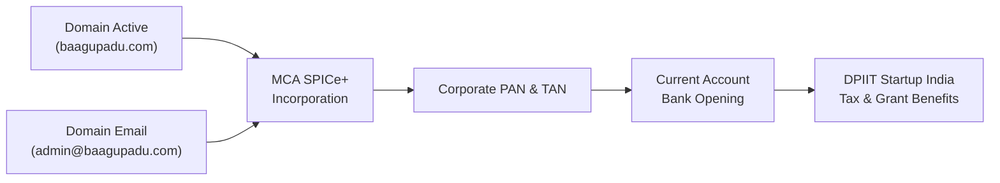

# Strategic Plan: Domain Activation, Corporate Email & Incorporation Readiness

**Domain**: `baagupadu.com`  
**Registrar**: Hostinger  
**Objective**: Immediate public web presence, domain-verified business email addresses, and regulatory readiness for company incorporation—with **$0 upfront compute cost** and zero premature architecture lock-in.

---

## 1. Executive Summary & Founder Intent

### 1.1 The Context
Baagupadu has secured its primary brand identity via the domain `baagupadu.com` on Hostinger. At this stage:
1. **Primary Goal**: Activate the domain immediately so that anyone visiting (MCA corporate registrar, bank officers, investors, academic partners) sees an active, polished, professional platform.
2. **Official Communication**: Stand up corporate email inboxes (`contact@baagupadu.com`, `admin@baagupadu.com`) required for formal legal incorporation (MCA SPICe+), Startup India recognition, and vendor agreements.
3. **Architecture Neutrality**: The final deployment model—whether **B2C Cloud SaaS** or **B2B Institutional On-Premises/Local Server deployment** (e.g. college computer labs)—is still being evaluated.
4. **Capital Efficiency**: Avoid burning budget on cloud GPUs, managed databases, or cloud servers before product-market fit or pilot contracts are signed.

### 1.2 The Strategy: Decoupled Zero-Cost Architecture
By leveraging DNS separation of concerns:
* **Web Traffic (HTTP/HTTPS)** is delegated to **Vercel** (Free Tier), delivering the rich Next.js 16 landing page with global Edge CDN caching and automated SSL.
* **Email Traffic (SMTP/IMAP)** remains anchored on **Hostinger Business Email** (or Zoho / Google Workspace) via standard MX records.
* **API / Compute Tier (`api.baagupadu.com`)** is kept idle/local until institutional pilots or cloud requirements are finalized.

---

## 2. Decoupled Architecture Blueprint

---

## 3. Phase-by-Phase Implementation Roadmap

---

## 4. Phase 1: Zero-Cost Web Presence (Vercel + Hostinger)

### Step 1.1: Connect GitHub Repository to Vercel
1. Navigate to [vercel.com](https://vercel.com) and log in with your GitHub account.
2. Click **Add New** -> **Project**.
3. Select the repository: `Baagupadu/Baagupadu-AI-Companion`.
4. Configure Project Settings:
   * **Framework Preset**: Next.js (auto-detected).
   * **Root Directory**: Select `frontend` (crucial: do not build from the repository root).
   * **Build Command**: `npm run build`
   * **Output Directory**: `.next` (default).
5. Leave Environment Variables blank for now (or add public Clerk keys if demo auth is desired).
6. Click **Deploy**. Within 90 seconds, Vercel will output a preview URL (e.g., `baagupadu-frontend.vercel.app`).

### Step 1.2: Attach Custom Domain in Vercel
1. In the Vercel dashboard, navigate to **Settings** -> **Domains**.
2. Input `baagupadu.com` and click **Add**.
3. Vercel will prompt you to add both:
   * `baagupadu.com`
   * `www.baagupadu.com` (configured to redirect to apex or vice-versa).
4. Vercel will output the exact target DNS values:
   * **Apex (`@`)**: `76.76.21.21` (A Record)
   * **Subdomain (`www`)**: `cname.vercel-dns.com` (CNAME Record)

### Step 1.3: Update Hostinger DNS Zone Editor
1. Log in to **Hostinger hPanel** (`hpanel.hostinger.com`).
2. Navigate to **Domains** -> **`baagupadu.com`** -> **DNS / Nameservers**.
3. Modify the web records:

| Record Type | Name / Host | Value / Points To | TTL | Action |
| :--- | :--- | :--- | :--- | :--- |
| **A** | `@` | `76.76.21.21` | `3600` | Edit existing or add |
| **CNAME** | `www` | `cname.vercel-dns.com` | `3600` | Edit existing or add |

> [!WARNING]
> Do NOT touch or delete the existing **MX** records in Hostinger! Those are required for email delivery.

4. Wait 5 to 15 minutes. Vercel will verify the domain, auto-generate an SSL certificate (Let's Encrypt), and mark the domain with a green checkmark.

---

## 5. Phase 2: Corporate Email & Anti-Spoofing Configuration

### Step 2.1: Establish Inboxes in Hostinger Email Manager
In Hostinger hPanel -> **Emails** -> **`baagupadu.com`**, create the following accounts:

1. **`contact@baagupadu.com`**
   * Purpose: Primary public contact for the website footer, customer inquiries, and partner outreach.
2. **`admin@baagupadu.com`** (or `legal@baagupadu.com`)
   * Purpose: Formal corporate filing, Ministry of Corporate Affairs (MCA) communication, and banking documentation.
3. **`sreekar@baagupadu.com`** (or `founder@baagupadu.com`)
   * Purpose: Executive correspondence with angel investors, academic deans, and institutional decision-makers.

### Step 2.2: Email Authentication (SPF, DKIM, DMARC)
To guarantee your corporate emails do not land in spam folders during bank or government verification, ensure these DNS records exist in Hostinger:

1. **SPF Record (Sender Policy Framework)**:
   * **Type**: `TXT`
   * **Host**: `@`
   * **Value**: `v=spf1 include:_spf.mail.hostinger.com ~all`
2. **DKIM Record (DomainKeys Identified Mail)**:
   * Hostinger generates a unique `CNAME` or `TXT` record inside the Email dashboard. Verify that DKIM is toggled **Active**.
3. **DMARC Record (Domain-based Message Authentication)**:
   * **Type**: `TXT`
   * **Host**: `_dmarc`
   * **Value**: `v=DMARC1; p=quarantine; rua=mailto:admin@baagupadu.com`

### Step 2.3: Verification Test
1. Log in to [mail.hostinger.com](https://mail.hostinger.com).
2. Send an email to an external personal address (e.g. your Gmail).
3. Inspect the email headers in Gmail (click the three dots -> *Show original*).
4. Verify:
   * `SPF: PASS`
   * `DKIM: PASS`
   * `DMARC: PASS`

---

## 6. Phase 3: Corporate Incorporation & Compliance Package

When applying for company registration and formal standing in India:

### 6.1 Requirements Checklist for Government Portals

| Stage | Portal / Authority | Required Asset | How It Is Satisfied |
| :--- | :--- | :--- | :--- |
| **Name Reservation & Incorporation** | Ministry of Corporate Affairs (MCA SPICe+ Part A & B) | Official Company Email | Use `admin@baagupadu.com` |
| **Director Identification Number (DIN)** | MCA Portal | Applicant Email & Mobile | Use `sreekar@baagupadu.com` |
| **Digital Signature Certificate (DSC)** | Certified CA (eMudhra / Capricorn) | Identity verification video & email | Domain-linked email increases trust score |
| **Bank Current Account** | HDFC / ICICI / Kotak / Axis Bank | Verifiable Business Website | Bank inspector visits `https://baagupadu.com` |
| **Startup India Recognition** | DPIIT / Startup India Hub | Live Platform Proof & Link | Showcases AI mentoring engine & roadmap |

---

## 7. Phase 4: Preserving Architecture Flexibility (B2B vs B2C)

Because the web landing page and emails are handled independently, you have 100% architectural freedom to choose your backend model when ready:

| Consideration | Option A: B2C Cloud SaaS | Option B: B2B Institutional On-Premises |
| :--- | :--- | :--- |
| **Target Audience** | Individual students, working professionals | Colleges, Universities, EdTech institutions |
| **Data Residency** | Cloud multi-tenant (AWS / Render / Supabase) | Local on-prem college lab servers |
| **GPU / LLM Costs** | Cloud API pay-per-token (OpenAI / Groq) | On-prem Ollama / vLLM on local workstations (RTX 4090 / Mac Studio) |
| **Student Privacy** | Strict DPDP Act cloud compliance | Air-gapped / Local Intranet (Zero data leaks) |
| **API Domain Setup** | Set `api.baagupadu.com` -> Cloud Server IP | Set `api.baagupadu.com` -> Cloudflare Tunnel to Local Server |
| **Cost at Launch** | $20 - $100 / month | $0 cloud cost (leverages institutional hardware) |

### How to Bind the Backend When Ready:
When you decide to deploy the backend engine, you only need to execute one step in Hostinger DNS:
* Add an **A Record** (or CNAME) for `api.baagupadu.com` pointing to your server or tunnel.
* Your main website (`baagupadu.com`) and emails (`contact@baagupadu.com`) remain completely undisturbed.

---

## 8. Master Action Checklist

- [ ] **Step 1**: Import `Baagupadu-AI-Companion` into Vercel with Root Directory set to `frontend`.
- [ ] **Step 2**: Add `baagupadu.com` and `www.baagupadu.com` in Vercel project settings.
- [ ] **Step 3**: In Hostinger DNS, update `@` (A) record to `76.76.21.21` and `www` (CNAME) to `cname.vercel-dns.com`.
- [ ] **Step 4**: Confirm Hostinger MX records remain intact for mail delivery.
- [ ] **Step 5**: Create `contact@baagupadu.com`, `admin@baagupadu.com`, and `sreekar@baagupadu.com` in Hostinger Email.
- [ ] **Step 6**: Send test email and verify SPF/DKIM validation.
- [ ] **Step 7**: Verify `https://baagupadu.com` opens in a fresh browser with valid SSL.
- [ ] **Step 8**: Use `admin@baagupadu.com` and `https://baagupadu.com` to initiate MCA SPICe+ company registration.
