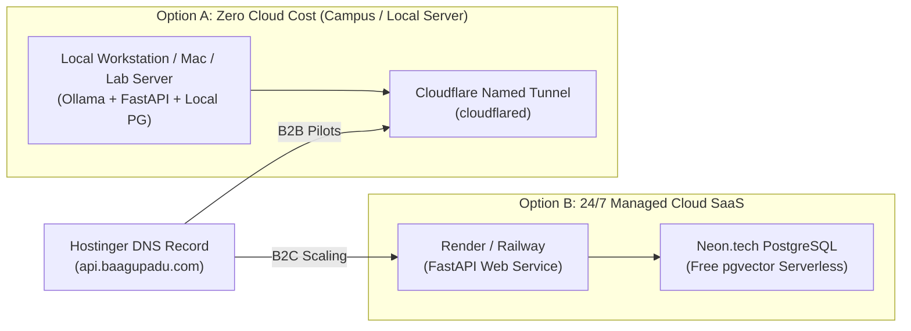

# Master Roadmap: Deploying Baagupadu via Hostinger Domain

**Target Domain:** `baagupadu.com`  
**Registrar & DNS:** Hostinger  
**Source Repository:** `Baagupadu/Baagupadu-AI-Companion` (Branch: `main`)  
**Architecture:** Decoupled Edge Web Tier + Independent Business Mail + Zero-Cost Backend Routing  
**Author:** Baagupadu Engineering & DevOps Team  
**Date:** October 2026 | Version: 1.0.0  

---

## 1. Executive Deployment Architecture

To achieve high availability, sub-second global load times, and $0 upfront compute costs while maintaining complete architectural flexibility between B2C Cloud SaaS and B2B Campus On-Premises deployments, Baagupadu utilizes a **decoupled DNS routing model**:

```mermaid
flowchart TD
    Visitor["Public Visitors / Students / Partners"]
    GovtBank["MCA Registrars / Bank Verification Officers"]
    InboundMail["Incoming / Outgoing Emails"]

    subgraph HostingerDNS ["Hostinger DNS Zone (baagupadu.com)"]
        ARecord["@ (Apex) ──> A Record: 76.76.21.21"]
        CNAME_WWW["www ──> CNAME Record: cname.vercel-dns.com"]
        MXRecords["MX Records ──> Hostinger Business Mail (Pri 10 & 20)"]
        TXTRecords["TXT Records ──> SPF, DKIM, DMARC Deliverability"]
        SubdomainAPI["api ──> CNAME: Cloudflare Tunnel / Cloud Backend"]
    end

    subgraph WebTier ["Frontend Web Tier (Vercel Edge - Free Tier)"]
        VercelCDN["Vercel Global Edge Network\n• Auto Let's Encrypt SSL\n• Next.js 16 App Router\n• Global Asset Caching"]
        LiveLanding["Live Portal (https://baagupadu.com)\n• Brand Heritage & Telugu Meaning\n• Scrollytelling Mentorship Stage\n• B2B Campus Edition Card\n• Corporate Footer & Privacy Terms"]
    end

    subgraph EmailTier ["Corporate Communications Tier (Hostinger Titan)"]
        ContactBox["contact@baagupadu.com (Public & Institutional Inquiries)"]
        AdminBox["admin@baagupadu.com (MCA SPICe+ & Bank Account)"]
        FounderBox["founder@baagupadu.com (Executive & Investor Relations)"]
    end

    subgraph BackendTier ["Backend & AI Compute Tier (api.baagupadu.com)"]
        Tunnel["Cloudflare Named Tunnel OR Render/Railway"]
        FastAPI["FastAPI 0.115 + LangGraph Engine"]
        Database["PostgreSQL 16 + pgvector"]
    end

    Visitor -->|HTTPS: baagupadu.com| ARecord
    Visitor -->|HTTPS: www.baagupadu.com| CNAME_WWW
    GovtBank -->|Verifies legitimacy| ARecord
    ARecord --> VercelCDN
    CNAME_WWW --> VercelCDN
    VercelCDN --> LiveLanding

    InboundMail -->|SMTP / IMAP| MXRecords
    MXRecords --> ContactBox
    MXRecords --> AdminBox
    MXRecords --> FounderBox
    TXTRecords -.->|Authenticates DMARC| InboundMail

    LiveLanding -.->|Client API Calls (Bearer JWT)| SubdomainAPI
    SubdomainAPI --> Tunnel
    Tunnel --> FastAPI
    FastAPI --> Database
```

---

## 2. Phase 1: Deploying the Frontend to Vercel ($0 Cost)

Vercel provides native compilation for Next.js 16 App Router applications, edge caching, and automated HTTPS certificate provisioning at zero cost.

### Step 1.1: Import GitHub Repository
1. Navigate to **[vercel.com](https://vercel.com)** and log in with your GitHub account (`Sreekarreddy2005`).
2. On your Vercel Dashboard, click **Add New…** → **Project**.
3. Under *Import Git Repository*, locate **`Baagupadu/Baagupadu-AI-Companion`** and click **Import**.

### Step 1.2: Configure Project & Build Parameters
Configure the following project settings carefully:
* **Project Name**: `baagupadu-portal` (or `baagupadu`)
* **Framework Preset**: `Next.js` (auto-detected)
* **Root Directory**: Click **Edit** and choose **`frontend`**  
  > [!IMPORTANT]
  > You MUST set the root directory to `frontend`. The repository contains both `backend` and `frontend`; pointing Vercel to root will result in a failed build.
* **Build Command**: `npm run build`
* **Output Directory**: `.next`
* **Install Command**: `npm install`

### Step 1.3: Add Environment Variables
In the *Environment Variables* section, add:

| Key | Example Value | Description |
| :--- | :--- | :--- |
| `NEXT_PUBLIC_BACKEND_URL` | `https://api.baagupadu.com` | Production API endpoint |
| `NEXT_PUBLIC_CLERK_PUBLISHABLE_KEY` | `pk_test_...` *(or production key)* | Clerk Auth Publishable Key |
| `CLERK_SECRET_KEY` | `sk_test_...` *(or production key)* | Clerk Auth Secret Key |

4. Click **Deploy**. Vercel will install dependencies, build the Next.js production bundle, and assign an active staging URL (e.g., `baagupadu-portal.vercel.app`).

---

## 3. Phase 2: Hostinger DNS Zone Configuration

To map your custom domain `baagupadu.com` to your live Vercel deployment without disrupting existing email configurations:

### Step 2.1: Add Domain to Vercel
1. In the Vercel Dashboard, open your project → **Settings** → **Domains**.
2. Type **`baagupadu.com`** and click **Add**.
3. Vercel will recommend adding both:
   * `baagupadu.com` (Apex domain)
   * `www.baagupadu.com` (Redirects to `baagupadu.com`)
4. Vercel will display the target DNS records needed.

### Step 2.2: Update Records in Hostinger hPanel
1. Open **[hpanel.hostinger.com](https://hpanel.hostinger.com)**.
2. Go to **Domains** → click **`baagupadu.com`** → select **DNS / Nameservers** from the sidebar.
3. Configure the following two records:

| Record Type | Name / Host | Points to / Target Value | TTL | Action in Hostinger |
| :---: | :---: | :---: | :---: | :--- |
| **A** | `@` | `76.76.21.21` | `300` (or Default) | **Edit** existing `@` A record |
| **CNAME** | `www` | `cname.vercel-dns.com` | `300` (or Default) | **Edit** or **Add** `www` CNAME record |

> [!CAUTION]
> **DO NOT modify, edit, or delete the MX records** (`mx1.hostinger.com`, `mx2.hostinger.com`). Those records are required for your Hostinger business email accounts to receive incoming mail.

### Step 2.3: Verification & SSL Provisioning
* DNS propagation typically takes **5 to 15 minutes** (maximum 2 hours).
* Once propagated, Vercel will automatically provision a free **Let's Encrypt Wildcard SSL** certificate.
* Both `https://baagupadu.com` and `https://www.baagupadu.com` will show a valid green padlock.

---

## 4. Phase 3: Official Business Email & Deliverability Suite

Official domain-linked emails are essential for Ministry of Corporate Affairs (MCA) incorporation, corporate bank account applications, and institutional trust.

### Step 3.1: Create Inboxes in Hostinger
1. In Hostinger hPanel, navigate to **Emails** → **`baagupadu.com`**.
2. Click **Create Email Account** and establish the following mailboxes:

| Email Address | Mailbox Role | Primary Purpose |
| :--- | :--- | :--- |
| **`contact@baagupadu.com`** | Public & Institutional | Displayed in website footer; handles university queries and student feedback. |
| **`admin@baagupadu.com`** | Regulatory & Legal | Used for MCA SPICe+ company filing, GST, PAN/TAN registration, and bank accounts. |
| **`founder@baagupadu.com`** | Executive & Investor | Direct communications with angel investors, college principals, and advisors. |

### Step 3.2: Anti-Spoofing & Deliverability Configuration (SPF, DKIM, DMARC)
To guarantee your corporate emails never land in spam filters during government verification or banking checks, verify the following records in Hostinger DNS:

1. **SPF Record (Sender Policy Framework)**:
   * **Type**: `TXT`
   * **Host**: `@`
   * **Value**: `v=spf1 include:_spf.mail.hostinger.com ~all`
2. **DKIM Record (DomainKeys Identified Mail)**:
   * In Hostinger Email Dashboard → **Settings** → verify that **DKIM** is toggled **Active**.
3. **DMARC Record (Domain-based Message Authentication)**:
   * **Type**: `TXT`
   * **Host**: `_dmarc`
   * **Value**: `v=DMARC1; p=quarantine; rua=mailto:admin@baagupadu.com`

### Step 3.3: Verification Test
1. Log into webmail at **[mail.hostinger.com](https://mail.hostinger.com)** using your newly created credentials.
2. Send a test email to your personal Gmail account.
3. In Gmail, click the three vertical dots on the email → **Show original**.
4. Confirm all three authentication headers state **PASS**:
   * `SPF: PASS`
   * `DKIM: PASS`
   * `DMARC: PASS`

---

## 5. Phase 4: Clerk Authentication Production Setup

To transition user authentication from testing mode to live production on `baagupadu.com`:

1. Open the **[Clerk Dashboard](https://dashboard.clerk.com)**.
2. Switch your application from **Development** to **Production** (or click *Create Production Instance*).
3. Under **Configure** → **Domains**:
   * Add **`baagupadu.com`**.
4. Copy the production credentials:
   * `NEXT_PUBLIC_CLERK_PUBLISHABLE_KEY`: `pk_live_...`
   * `CLERK_SECRET_KEY`: `sk_live_...`
5. In Vercel Project Settings → **Environment Variables**, update these keys and trigger a redeployment.

---

## 6. Phase 5: Backend & AI Engine Roadmap (`api.baagupadu.com`)

Because the web frontend and emails are decoupled from the backend compute, you have complete freedom to choose when and how to deploy the AI backend:



### Option A: Zero Cloud Cost (Local / College Lab Server + Cloudflare Tunnel)
* **Best for**: Initial launch, B2B university pilots, and testing without monthly cloud bills.
* **Mechanism**: Run `docker compose up -d` on your local Mac or an institutional server. Use Cloudflare Tunnel to expose `localhost:8000` to `api.baagupadu.com`.
* **Cost**: **$0 / month**.

### Option B: Managed Serverless Cloud
* **Best for**: 24/7 public B2C consumer traffic.
* **Database**: **Neon.tech** (Serverless PostgreSQL with native `pgvector` extension support — free tier).
* **Backend**: **Railway** or **Render** deploying `backend/Dockerfile`.
* **Cost**: **$0 – $7 / month**.

### Connecting `api.baagupadu.com` in Hostinger
Whenever you choose to deploy the backend:
1. Open Hostinger DNS.
2. Add a **CNAME** record:
   * **Host**: `api`
   * **Target**: `<your-backend-service>.up.railway.app` (or your Cloudflare Tunnel CNAME).
   * **TTL**: `300`
3. Your main landing page (`baagupadu.com`) and business emails (`contact@baagupadu.com`) remain completely unaffected.

---

## 7. Phase 6: Company Incorporation & Regulatory Milestone Checklist

Having `baagupadu.com` live and official emails active enables immediate progress on corporate legal identity in India:

| Step | Milestone | Portal | Requirement Met By This Roadmap |
| :---: | :--- | :--- | :--- |
| **1** | **Company Name Reservation** | MCA SPICe+ Part A | Official company email `admin@baagupadu.com` |
| **2** | **Director Identification (DIN)** | MCA Portal | Applicant verified email `founder@baagupadu.com` |
| **3** | **Digital Signature Certificate (DSC)** | Certified CA (eMudhra/Capricorn) | Higher trust score with domain-verified email |
| **4** | **Company Incorporation (Pvt Ltd / LLP)** | MCA SPICe+ Part B | Registered corporate domain `https://baagupadu.com` |
| **5** | **Corporate Current Account** | Bank (HDFC / ICICI / Kotak) | Working live portal for bank digital inspection |
| **6** | **DPIIT Startup India Recognition** | Startup India Hub | Live working platform link showing AI innovation |

---

## 8. Master Step-by-Step Execution Summary

- [ ] **Step 1**: Import `Baagupadu/Baagupadu-AI-Companion` into Vercel with Root Directory set to `frontend`.
- [ ] **Step 2**: Add `baagupadu.com` and `www.baagupadu.com` in Vercel project domains.
- [ ] **Step 3**: In Hostinger DNS, update `@` (A) record to `76.76.21.21` and `www` (CNAME) to `cname.vercel-dns.com`.
- [ ] **Step 4**: Confirm Hostinger MX records remain untouched for email delivery.
- [ ] **Step 5**: Create `contact@baagupadu.com`, `admin@baagupadu.com`, and `founder@baagupadu.com` in Hostinger Email.
- [ ] **Step 6**: Send test email and verify SPF/DKIM validation.
- [ ] **Step 7**: Verify `https://baagupadu.com` opens in a fresh browser with valid SSL.
- [ ] **Step 8**: Use `admin@baagupadu.com` and `https://baagupadu.com` to initiate MCA SPICe+ company registration.
